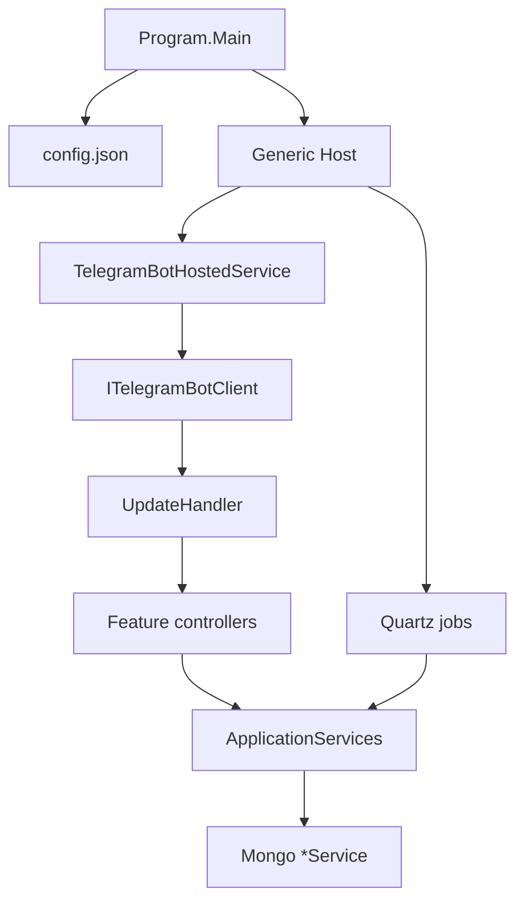

# Архитектура

TamagotchiBot — консольное приложение на Generic Host. Это не ASP.NET и не webhook-сервер: бот ходит в Telegram через **long polling**.

## Поток запуска

Точка входа: [`TamagotchiBot/Program.cs`](../TamagotchiBot/Program.cs), namespace `Telegram.Bots.Example`.

1. Serilog пишет в консоль и в `Logs/yyyy/MM/dd-.txt` рядом с бинарём.
2. Если нет `config.json` в `AppDomain.CurrentDomain.BaseDirectory`, создаётся шаблон через `CreateDefaultConfig()` и процесс **завершается**.
3. `HostBuilder` поднимает DI, Quartz и `TelegramBotHostedService`.
4. `ITelegramBotClient` создаётся **не из** `EnvsSettings.TokenBot`, а из Mongo: `SInfoService.GetBotToken()` (поле `ServiceInfo.TmgToken`).
5. [`TelegramBotHostedService`](../TamagotchiBot/Services/TelegramBotHostedService.cs) вызывает `_client.StartReceiving(updateHandler: _updateHandler)` и висит на `Task.Delay(Timeout.Infinite)`.

## Слои

| Слой | Где | Назначение |
|------|-----|------------|
| Host / DI | `Program.cs` | Регистрация сервисов, Quartz, локализация |
| Polling | `TelegramBotHostedService` | Приём апдейтов |
| Routing | [`Handlers/UpdateHandler.cs`](../TamagotchiBot/Handlers/UpdateHandler.cs) | Тип апдейта → private / group / платежи |
| Feature-контроллеры | [`Controllers/`](../TamagotchiBot/Controllers/) | Не MVC: обычные классы сценариев |
| Фасад | [`ApplicationServices`](../TamagotchiBot/Services/ApplicationServices.cs) | Агрегирует Mongo, платежи, `BotControlService` |
| Persistence | [`Services/Mongo/`](../TamagotchiBot/Services/Mongo/) | `MongoServiceBase<T>` + конкретные сервисы |
| Константы игры | [`UserExtensions/Constants.cs`](../TamagotchiBot/UserExtensions/Constants.cs) | Цены, факторы, команды, стикеры |
| Модели | [`Models/Mongo/`](../TamagotchiBot/Models/Mongo/) | Документы Mongo |

Отдельного слоя репозиториев / domain-событий нет: контроллеры ходят в Mongo-сервисы через `IApplicationServices`.

## Контроллеры

Это feature-классы, не ASP.NET MVC. `UserController.cs` в csproj помечен `Compile Remove` и в сборку не входит.

| Класс | Роль |
|-------|------|
| `MenuController` | Основное меню: уход, работа, учёба, магазин-кухня, ранги, Gemini/OpenAI-чат |
| `CreatorController` | Онбординг, язык, переименование, VIP/подтверждения, **ленивый decay** (`UpdateIndicators`) |
| `AdminController` | Админ-команды для пользователей из `AlwaysNotifyUsers` |
| `AppleGameController` / `TicTacToeGameController` / `HangmanGameController` | Мини-игры |
| `MultiplayerController` | Группы: показ питомца, дуэли, кормление, ранги чата |
| `SetCommandController` | Обновление списка команд бота под аудиторию и язык |
| `SynchroDBController` | Синхронизация имени/username и групповых чатов с БД |
| `ForwardController` | Пересылка сообщений в dev-чат |
| `HttpController` | Внешние HTTP-вызовы (в т.ч. Botstat) |

Исходящие ответы собираются в `AnswerMessage` / `AnswerCallback` и отправляются через `BotControlService`.

## DI (кратко)

В `CreateHostBuilder` регистрируются:

- `TelegramBotHostedService`, `IUpdateHandler` → `UpdateHandler`
- `IApplicationServices` → `ApplicationServices`
- все `*Service` из Mongo, `PaymentService`, `BotControlService`, `RandomEventService`
- `ITamagotchiDatabaseSettings` и `IEnvsSettings` из секций `config.json`
- `AddLocalization(ResourcesPath = "Resources")`
- Quartz jobs + `AddQuartzHostedService`

`ITelegramBotClient` регистрируется во втором `ConfigureServices`, уже после Mongo-сервисов, чтобы прочитать токен из БД.

## Конфигурации сборки

См. [`TamagotchiBot.csproj`](../TamagotchiBot/TamagotchiBot.csproj) и [разработку](development.md):

| Configuration | Assembly / символы | Заметки |
|---------------|--------------------|---------|
| `Debug` | обычное имя | Локальная отладка |
| `Release` | `TamagotchiBot.Production`, `RELEASE` | Прод |
| `Staging` / `Staging_Local` | `TamagotchiBot.Staging`, `STAGING` | Стейджинг (Subgram ads отключены) |
| `Debug-Notify` | добавляет `DEBUG` | В коде есть `#if DEBUG_NOTIFY` для частых джоб |
| `Debug-Hotfix` | без особых символов в csproj | Точечные хотфиксы |

Подробности по игровому циклу — [игровая логика](game-mechanics.md), по апдейтам — [Telegram-поток](telegram-flow.md).
