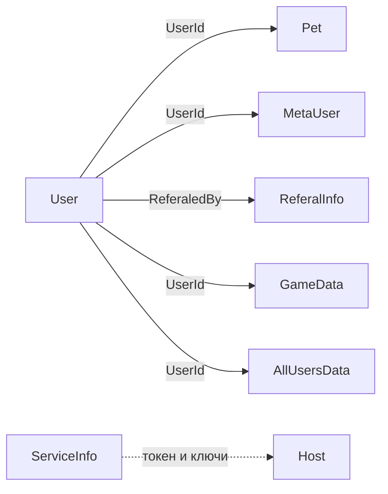

# Модель данных

Хранилище — **MongoDB** (`MongoDB.Driver` 2.22.0). Отдельного ORM/репозиторного слоя нет.

База: [`MongoServiceBase<T>`](../TamagotchiBot/Services/Mongo/MongoServiceBase.cs). Строка подключения собирается из переменных окружения (см. [конфигурацию](configuration.md)), имя БД — `TamagotchiDatabaseSettings.DatabaseName` (по умолчанию `TamagotchiDb`).

Имя коллекции обычно совпадает с именем класса, кроме карты `EditedClassNames`:

| Тип | Коллекция |
|-----|-----------|
| `AppleGameData` | `AppleGame` |
| `Chat` | `Chats` |
| `Pet` | `Pets` |
| `User` | `Users` |
| `StarPayment` | `StarPayments` |
| `BonusCode` | `BonusCodes` |

Остальные типы берутся как `typeof(T).Name` (например `MetaUser`, `ServiceInfo`).

Все документы наследуют [`MongoModelBase`](../TamagotchiBot/Models/Mongo/MongoModelBase.cs): `_id`, `Created`, `Updated`.

## Коллекции и сервисы

Имена коллекций в шаблоне `config.json` задаёт `CreateDefaultConfig()` в [`Program.cs`](../TamagotchiBot/Program.cs).

| Коллекция (шаблон) | Модель | Сервис |
|--------------------|--------|--------|
| `Users` | `User` | `UserService` |
| `Pets` | `Pet` | `PetService` |
| `PetsBackup` | бэкап питомцев | через `PetService` / настройки |
| `UsersBackup` | бэкап пользователей | в настройках БД |
| `MetaUser` | `MetaUser` | `MetaUserService` |
| `Chats` | `Chat` | `ChatService` (помечен Obsolete в фасаде) |
| `ChatsMP` | `ChatsMP` | `ChatsMPService` |
| `ServiceInfo` | `ServiceInfo` | `SInfoService` |
| `AllUsersData` | `AllUsersData` | `AllUsersDataService` |
| `DailyInfo` | `DailyInfo` | `DailyInfoService` |
| `BannedUsers` | `BannedUsers` | `BannedUsersService` |
| `AdsProducers` | `AdsProducers` | `AdsProducersService` |
| `ReferalInfo` | `ReferalInfo` | `ReferalInfoService` |
| `ArchiveUserInfo` | `ArchiveUserInfo` | `ArchiveUserInfoService` |
| `AppleGame` | `AppleGameData` | `AppleGameDataService` |
| `TicTacToeGameData` | `TicTacToeGameData` | `TicTacToeGameDataService` |
| `HangmanGameData` | `HangmanGameData` | `HangmanGameDataService` |
| `StarPayments` | `StarPayment` | `PaymentService` |
| `BonusCodes` | `BonusCode` | `BonusCodeService` |

Фасад: [`IApplicationServices`](../TamagotchiBot/Services/Interfaces/IApplicationServices.cs).

## Ключевые поля

### Pet

Связь с игроком: `UserId`. Статы: `HP`, `Satiety`, `Joy`, `Fatigue`, `Hygiene`, `EXP`, `Level`, `LevelAllGame`. Статус: `CurrentStatus`, `CurrentJob`, таймеры `StartWorkingTime`, `StartSleepingTime`, `ToWakeUpTime`, `StartStudyingTime`. Образование: `EducationLevel`, `EducationStage`. Флаги: `IsGone`, `IsAutoFeedEnabled`. Мультиплеер: `MPSatiety`, `LastMPFedTime`. Случайные события: `GotRandomEventTime`, `NextRandomEventNotificationTime`. Decay опирается на `LastUpdateTime`.

### User

Профиль Telegram (`UserId`, `Username`, `FirstName`, `LastName`, `ChatIds`), `Culture`, валюты `Gold` / `Diamonds`, VIP (`VIPIsEnabled`, `VIPStartTime`, `VIPLongDays`), реферал (`ReferaledBy`, `DiamondsGotByRef`), `AutoFeedCharges`, `OwnedPetTypes`, флаги мини-игр, таймеры ежедневной награды.

### MetaUser

Состояния диалогов, которые не стоит класть в `User`: переименование (`IsPetNameAskedOnRename`, `IsAskedToConfirmRenaming`, `TmpPetName`), VIP/покупки (`IsConfirmAskedOnVIP7daysBuying`, `PendingConfirmation`), дуэль (`MsgDuelId`, `ChatDuelId`, `DuelStartTime`, `NextPossibleDuelTime`), MP-кормление, Subgram (`LastSubgramCheckingTime`), истории `LastChatGptQA` / `LastGeminiQA`, `UsedBonusCodes`.

### ServiceInfo

Один операционный документ: флаги `DoMaintainWorks` / `DoSendChangelogs`, токен бота `TmgToken`, ключи Gemini/OpenAI/Subgram, `GeminiModel`, `MaxGeminiHistory`, `BannedWords`, таймеры dev-notify и Botstat.

Это не игровая коллекция: без валидного `TmgToken` клиент Telegram не поднимется.

## Связи (логически)

Жёстких foreign key в Mongo нет: сервисы читают по `UserId`.
