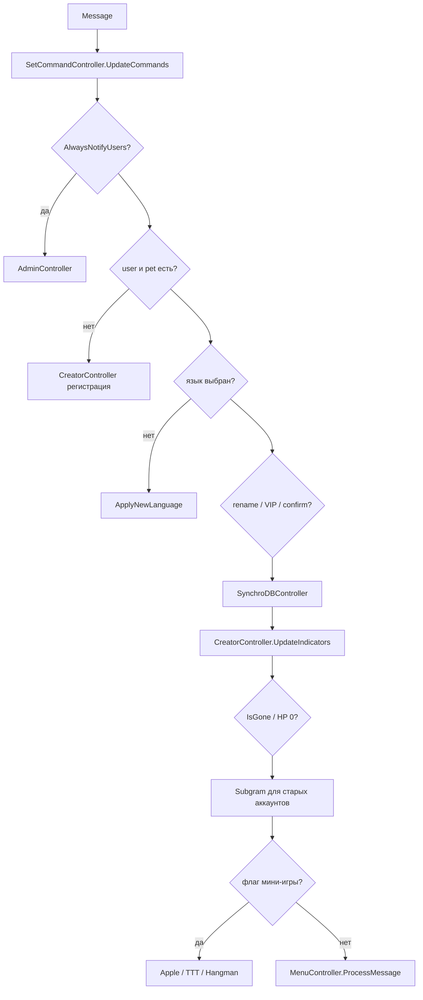

# Telegram-поток

Библиотека: `Telegram.Bot` 22.7.6. Режим: **polling** (`StartReceiving`). Webhook не используется.

Маршрутизация: [`UpdateHandler`](../TamagotchiBot/Handlers/UpdateHandler.cs) реализует `IUpdateHandler`.

## Типы апдейтов

| `Update.Type` | Обработчик |
|---------------|------------|
| `Message` | `BotOnMessageReceived` → private / group; `SuccessfulPayment` отдельно |
| `CallbackQuery` | private → меню / PreStart игр; group → `MultiplayerController` |
| `PreCheckoutQuery` | оплата Stars |
| `MyChatMember` | членство бота в чате |
| остальное | лог Verbose, no-op |

Сообщения не-текстовые (кроме new/left chat member и successful payment) игнорируются. Форварды и чаты из `EnvsSettings.ChatsToDevNotify` пропускаются.

## Private message

Упрощённо по коду `OnMessagePrivate`:

1. Если `userId` в `AlwaysNotifyUsers` — сначала `AdminController.ProcessMessage()`; при `true` обычная игра не идёт.
2. Кулдаун `TimesToWait.CooldownOnMessage` (500 мс) на пару user/chat.
3. Нет пользователя/питомца → регистрация (`RegisterUserAndPet` / `CreatorController`).
4. Нет языка → `ApplyNewLanguage`.
5. Сценарии переименования и подтверждения VIP / `PendingConfirmation`.
6. `SynchroDBController.SynchronizeWithDB` (имя, username).
7. `UpdateIndicators` — decay и таймеры.
8. Питомец ушёл или HP = 0 → воскрешение / смерть.
9. Для аккаунтов старше суток — `SendSubgramAds` (в DEBUG/STAGING всегда пропускается).
10. Активная мини-игра → её `Menu()`, иначе `MenuController.ProcessMessage()`.

Перед обработкой `SetCommandController` обновляет список команд бота под private/group и культуру пользователя (по умолчанию `"ru"`).

## Private callback

Мини-игры на колбэках **не** продолжаются: если `IsInAppleGame` / TTT / Hangman — callback игнорируется. Исключение — кнопки PreStart из игровой комнаты (`CallbackButtons.GameroomCommand.*`), которые запускают `PreStart()` контроллера игры.

Иначе: sync → `UpdateIndicators` → `MenuController.CallbackHandler()`.

## Группы

`chatId < 0` → `MessageAudience.Group`.

Сообщения: new/left member (в т.ч. добавление самого бота) или текст → `MultiplayerController`. Команды: `show_pet`, `start_duel`, `feed_pet`, `ranks` (`Constants.CommandsMP`).

Колбэки группы: если нет user/pet — alert `MPNoPetCallbackAlert`; иначе sync user + `SynchronizeMPWithDB` и `MultiplayerController.CallbackHandler()`.

## Команды игрока

Строковые имена: `Constants.Commands`. `MenuController` принимает и `/command`, и локализованный текст кнопки.

Игровые: `pet`, `kitchen`, `sleep`, `bathroom`, `hospital`, `gameroom`, `work`, `education`, `reward`, `referal`, `farm`, `ranks`, `rename`, `language`, `menu`, `help`, `changelog`, `quit`.

Админские (только `AlwaysNotifyUsers`): `check`, `kill`, `restart`, `gold`, `start_botstat_check`, `status_botstat_check`.

## Платежи Stars

- `PreCheckoutQuery` → `OnPreCheckoutQuery` (проверка пакета из `Constants.PaymentItems`).
- `MessageType.SuccessfulPayment` → `OnSuccessfulPayment` → `PaymentService` пишет `StarPayment` и начисляет алмазы.

## Ответы в Telegram

Контроллеры не дергают клиент напрямую в большинстве сценариев: собирают `AnswerMessage` / `AnswerCallback`, отправляет [`BotControlService`](../TamagotchiBot/Services/BotControlService.cs) (текст, стикер, reply/inline keyboard, parse mode).
